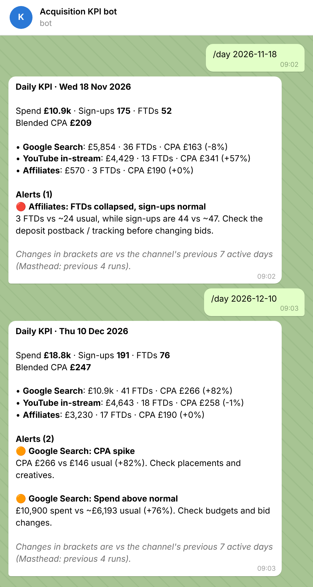

# Acquisition KPI Telegram bot (iGaming)

A Telegram bot for a paid acquisition team. Every morning it posts yesterday's
spend, sign-ups, first-time depositors (FTDs) and CPA per channel, and flags
anything that looks wrong before the team starts changing bids.



*Preview rendered from the bot's real output on the demo data.*

## What it catches

| Alert | Rule | Typical cause |
|---|---|---|
| 🔴 FTDs collapsed, sign-ups normal | FTDs < 30% of usual while sign-ups > 60% of usual | broken deposit postback or tracking |
| 🟠 Sign-up → FTD conversion drop | conversion < 55% of usual (≥ 30 sign-ups) | deposit flow or payment method failing |
| 🟠 CPA spike | CPA > 160% of usual | poor placements, tired creatives |
| 🟠 Spend above normal | spend > 140% of usual (bid-priced channels only) | budget or bid strategy changed |

"Usual" is each channel's own baseline: its previous 7 active days, or its previous
4 runs for channels bought in bursts (YouTube Masthead). Affiliates are paid per FTD,
so their spend is never flagged.

Thresholds were tuned on 12 weeks of clean simulated history: they fire once there,
on a genuine outlier day. The demo data adds three incidents on purpose and the
tests check that each one is caught.

## Commands

| Command | What it does |
|---|---|
| `/today` | digest for the latest day |
| `/day 2026-11-18` | digest for any day (try 18 Nov, 3 Dec, 10 Dec) |
| `/week` | last 7 days by channel, CPA vs the week before |
| `/alerts` | all alerts from the last 60 days |
| `/id` | this chat's ID, for the allow-list |

## Run it

```bash
pip install -r requirements.txt
python preview.py --day 2026-11-18     # see the output in the terminal, no token needed

cp .env.example .env                   # add BOT_TOKEN from @BotFather
python bot.py
python -m unittest discover -s tests
```

Only chats listed in `ALLOWED_CHAT_IDS` can use the bot; send `/id` to get a chat's ID.
The morning digest goes to `DIGEST_CHAT_IDS` at `DIGEST_TIME` in `TIMEZONE`.

## Project layout

```
bot.py              aiogram 3 handlers, allow-list, scheduled morning digest
report.py           baselines, alert rules and message formatting (no Telegram code)
preview.py          print any message in the terminal
make_demo_data.py   adds three incidents to the simulated history
demo_data/          daily.csv used by the demo
tests/              alert rules, scheduling, and handlers driven through a fake Telegram session
```

## Plugging in real data

The bot reads one CSV (`DATA_PATH`) with `date, channel, spend, registrations, ftds`
and re-reads it on every request, so a nightly export from the ad platforms and the
back office is enough. To read from a database instead, replace `load_daily()` in
`report.py`; nothing else changes.

## Related projects

- [Compliance-ready landing page](https://github.com/nkd077/igaming-compliance-landing): where the paid traffic lands
- [Paid media payback dashboard](https://github.com/nkd077/igaming-marketing-dashboard): the same data, analysed for payback; this bot's demo data comes from it

---

Built by **nkd077** · Python, aiogram 3, pandas
